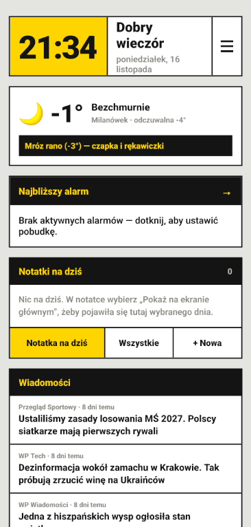
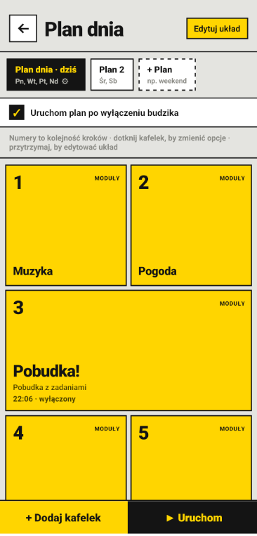
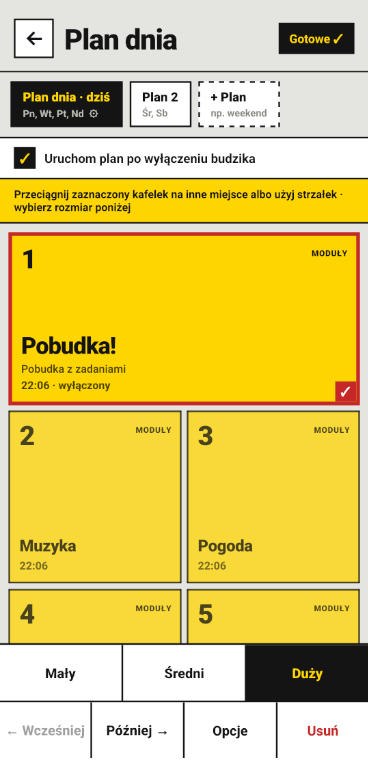
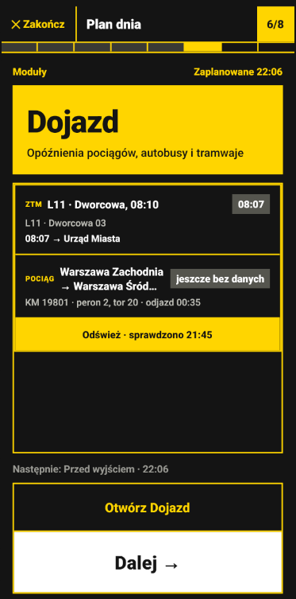

# SmartMorning

**Aplikacja na Androida do porannej rutyny: budzik, którego nie da się wyłączyć bez wstania z łóżka, a potem plan poranka prowadzony krok po kroku.**


## Najważniejsze

| | |
| --- | --- |
| 🔔 **Natywny moduł w Kotlinie** | [`modules/alarm-channel`](modules/alarm-channel) ([`AlarmChannelModule.kt`](modules/alarm-channel/android/src/main/java/expo/modules/alarmchannel/AlarmChannelModule.kt)) to własny moduł Expo, który odtwarza alarm na kanale audio `USAGE_ALARM`. Dzięki temu dzwoni jak prawdziwy budzik, a nie jak powiadomienie, działa w trybie cichym i nie milknie, dopóki zadania pobudki nie zostaną wykonane. |
| ✅ **172 testy automatyczne** | W [`__tests__/`](__tests__) są testy [jednostkowe](__tests__/unit), [integracyjne](__tests__/integration), [funkcjonalne](__tests__/functional) i [wydajnościowe](__tests__/performance). Uruchamia je `npm test`; całość trwa ok. 1,5 s i nie wymaga emulatora. |
| 🧩 **Algorytm układu kafelków** | [`src/routine/grid.ts`](src/routine/grid.ts) układa kafelki 1×1, 2×2 i 4×2 na siatce 4 kolumn, jak ekran Start w Windows 8, i zawsze wypełnia luki. Test sprawdza 50 losowych układów pod kątem nakładania się. |
| 🚆 **Dojazd po Warszawie na żywo** | [`src/transit/`](src/transit) korzysta z Otwartych Danych Kolejowych PKP PLK (opóźnienia, odwołania, utrudnienia). Autobusy i tramwaje nie mają oficjalnych danych o opóźnieniach, więc aplikacja szacuje je z pozycji GPS pojazdów ZTM. |
| 🔒 **Bez backendu** | Wszystkie dane zostają w telefonie. Klucze API wpisuje użytkownik i nigdy nie trafiają do repozytorium. |

## Zrzuty ekranu

<table>
  <tr>
    <td align="center"><br><sub>Pulpit: zegar, pogoda z poradą, alarm, notatki, wiadomości</sub></td>
    <td align="center"><br><sub>Plan dnia: plansza kafelków, numery = kolejność kroków</sub></td>
    <td align="center"><br><sub>Edycja układu: przeciąganie, rozmiar, kolejność</sub></td>
    <td align="center"><br><sub>Przebieg planu: krok Dojazd z danymi na żywo</sub></td>
  </tr>
</table>

## Funkcje

- **Budzik** z alarmami codziennymi, jednorazowymi lub na wybrane dni oraz pełnoekranowym ekranem pobudki na zablokowanym telefonie.
- **Zadania przed wyłączeniem alarmu**: matematyka (5 poziomów trudności), przepisanie frazy, potrząsanie telefonem, przejście określonej liczby kroków albo zeskanowanie własnego kodu QR (np. przyklejonego w łazience). Zob. [`src/challenges/`](src/challenges).
- **Plany poranka**: kilka planów przypisanych do dni tygodnia, układanych z przeciąganych kafelków. Każdy krok może mieć minutnik, który działa także w innej aplikacji, a godziny kroków wyliczają się automatycznie.
- **Kafelki**: wbudowane moduły (pogoda, notatki, wiadomości, muzyka, dojazd, checklista) oraz skróty otwierające ponad 15 zewnętrznych aplikacji (Gmail, Slack, Teams, Spotify, Duolingo…) lub dowolny własny link.
- **Pogoda** (Open-Meteo): okno 5:00–11:00 (dzisiejsze, a po 11:00 jutrzejsze) z poradami według ważności, np. „weź parasol” albo „mróz”.
- **Notatki** w Markdownie z paskiem narzędzi, automatyczną kontynuacją list i odhaczanymi zadaniami. Jedno dotknięcie otwiera notatkę „Plan na dziś”.
- **Wiadomości** z Google News RSS, przetwarzane własnym parserem bez zależności.
- **Checklista „Przed wyjściem”**, która zeruje się codziennie i dopisuje rzeczy zależne od pogody.
- **Przypomnienia o śnie** na podstawie pierwszego alarmu w każdym z najbliższych 7 dni.
- **Kolor akcentu** zmieniany na żywo, bez restartu aplikacji.

## Technologie

| Obszar | Technologia |
| --- | --- |
| Aplikacja | Expo SDK 58, React Native 0.88, TypeScript (strict), Expo Router |
| Warstwa natywna | Własny moduł Expo w Kotlinie, config pluginy w [`plugins/`](plugins) |
| Powiadomienia | `@notifee/react-native` (alarmy, minutniki kroków, przypomnienia o śnie) |
| Czujniki i kamera | `expo-sensors` (kroki, potrząsanie), `expo-camera` (QR) |
| Przechowywanie | AsyncStorage z migracjami starszych formatów danych |
| Testy | Jest 29, ts-jest |
| Dane | Open-Meteo, Google News RSS, Otwarte Dane Kolejowe PKP PLK, dane.um.warszawa.pl (ZTM) |

## Struktura projektu

```
src/
  app/          # trasy (Expo Router)
  alarm/        # alarmy, planowanie, ekran pobudki
  challenges/   # zadania pobudki (matematyka, fraza, potrząsanie, kroki, QR)
  routine/      # plany, siatka kafelków, minutniki, checklista
  weather/ news/ notes/ music/ transit/ sleep/
modules/alarm-channel/   # natywny moduł w Kotlinie (kanał audio alarmu)
plugins/                 # config pluginy Expo
__tests__/               # testy jednostkowe / integracyjne / funkcjonalne / wydajnościowe
```

## Uruchomienie

```bash
npm install
npx expo run:android      # build deweloperski na telefonie lub emulatorze
```

Aplikacja wymaga **buildu deweloperskiego**. Expo Go nie zadziała, bo projekt używa własnego modułu natywnego i biblioteki notifee.

Build release: `npx expo run:android --variant release`.

Windows: trzymaj projekt w krótkiej ścieżce (np. `C:\Dev\SM`) i włącz `LongPathsEnabled`, bo build C++ przekracza limit 260 znaków ścieżki.

Klucze API (PKP PLK, ZTM) są opcjonalne. Wpisuje się je w aplikacji w module **Dojazd** i są zapisywane tylko w telefonie.

## Testy

```bash
npm test                  # wszystkie 172 testy
npm run test:coverage     # raport pokrycia kodu
```

| Zestaw | Testy | Zakres |
| --- | --- | --- |
| Jednostkowe | 123 | planowanie alarmów, siatka kafelków, edytor Markdown, parser RSS, porady pogodowe, status pociągów i autobusów, pory snu |
| Integracyjne | 25 | zapis i migracje formatów, Open-Meteo → porady → checklista, utrudnienia PKP PLK → status pociągu |
| Funkcjonalne | 14 | trzy scenariusze użytkownika: poranek w dzień roboczy, notatka dnia, „czy zdążę na pociąg?” |
| Wydajnościowe | 10 | benchmarki względem budżetu klatki 16 ms (wszystkie z dużym zapasem) |

Testy obejmują warstwę logiki, a sieć i magazyn danych zastępują atrapami w pamięci, więc działają w zwykłym Node, bez urządzenia.

## Kontekst

Projekt zaliczeniowy z przedmiotu *Dynamiczna analiza oprogramowania* na SGGW. Zestaw testów powstał w ramach analizy dynamicznej wymaganej na zajęciach.

## Dane i licencje

Pogoda: [Open-Meteo](https://open-meteo.com/) (CC BY 4.0) · Kolej: Otwarte Dane Kolejowe PKP PLK · Komunikacja miejska: otwarte dane m.st. Warszawy (CC BY) · Wiadomości: Google News RSS.

## Licencja

[MIT](LICENSE)
